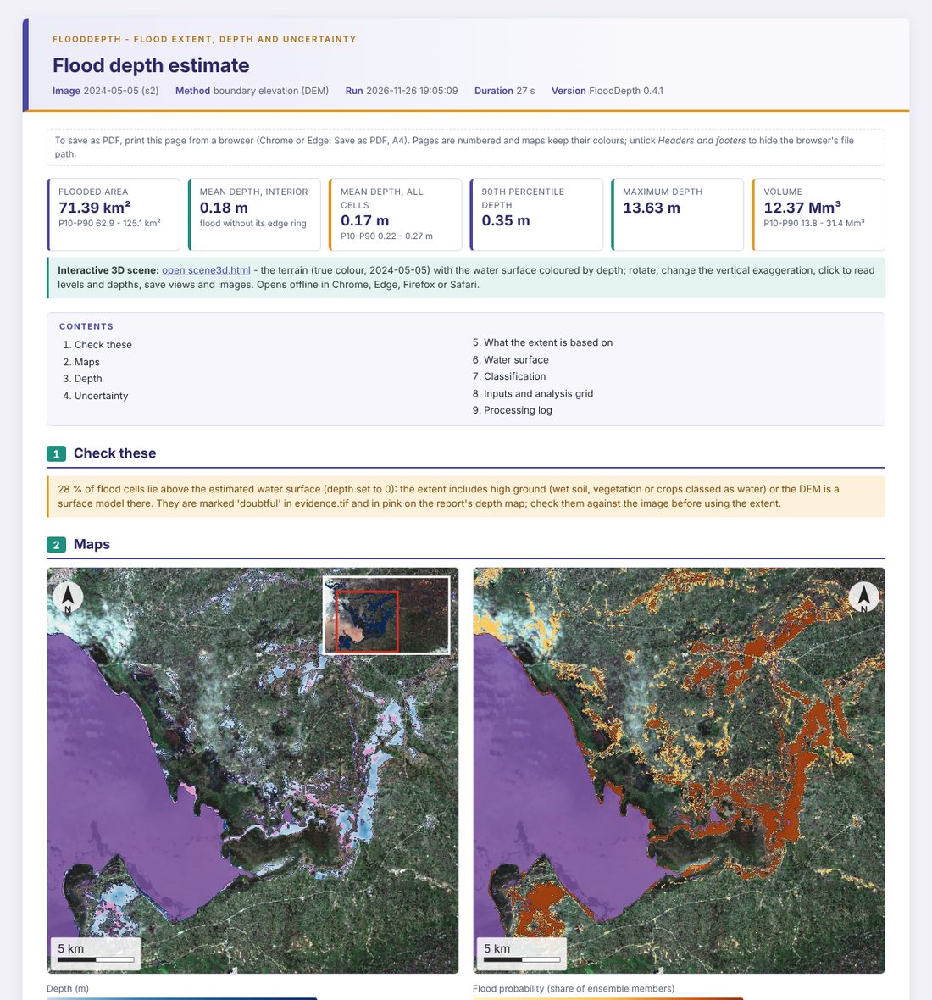

# FloodDepth — flood extent, depth and uncertainty for QGIS

FloodDepth turns a satellite image of a flood (or a flood-extent layer) and a DEM into a
flood-depth map with uncertainty bands and a printable report, in one run, entirely inside QGIS.
No external programs and no pip installs: it uses NumPy and the GDAL bindings that QGIS ships.

## What it does

- **Reads the files you downloaded as they are.** Copernicus / EO Browser "Raw" bands, Sentinel-2
  SAFE, Landsat Collection 2, multiband stacks and Sentinel-1 VV / VH are recognised from their
  names and metadata.
- **Maps the water** with NDWI plus confident MNDWI (or SAR backscatter) and an edge-based Otsu
  threshold. A threshold outside the physically usual range is refused with the reason, not used.
- **Removes permanent water** using a pre-event image, ESA WorldCover, JRC occurrence or lake polygons.
- **Maps flood traces**: for floods that drained before the overpass, it maps the vegetation lost
  between two dates and splits it into inundation and erosion / deposition.
- **Estimates depth.** The water surface comes from the terrain along the flood edge (FwDET
  boundary method, with outlier screening), or from a HAND raster. Depth = surface − DEM.
- **Quantifies uncertainty.** A Monte Carlo ensemble (correlated DEM error, threshold and edge
  perturbation, method error) gives depth P10 / P50 / P90 and flood probability. An evidence layer
  says what each flooded cell is based on.
- **Writes an HTML report** that prints to A4 PDF: maps over the satellite image, every automatic
  decision, warnings and limitations.
- **Builds an interactive 3D scene** (one offline HTML file): the terrain draped with the image, the
  water coloured by depth, and the mud and debris a flash flood leaves behind.
- **Gives you layers to work with**: depth, water-surface, evidence and probability GeoTIFFs and valid
  flood polygons in a GeoPackage, ready for zonal statistics, depth-class polygons, KML or DXF.
- **Handles national DEMs.** FABDEM, Copernicus GLO-30, ALOS, TanDEM-X, the **Google GEM 15 m DTM**
  or LiDAR, as one file or as tiles. Only the cells under the area are read.
- **Several dates**: depth per date, the maximum observed depth and the dates each cell flooded.

## Install

*Plugins › Manage and Install Plugins*, search **FloodDepth**, or *Install from ZIP* with a
[release](https://github.com/EdmondAkello/Flood-Depth/releases) zip. QGIS 3.44 to 4.x; nothing else
to install. When SciPy is present (most QGIS installs) a few steps use it; the results are the same
without it.

## Where to find it

| Place | What is there |
|---|---|
| **Raster › FloodDepth** | Quick Flood Depth, Flood Depth over Time, Prepare DEM, Export 3D Scene, Classify Water, Compare Flood Extents, **User Guide** |
| **Raster toolbar** | One FloodDepth button: a click opens Quick Flood Depth, the arrow lists the rest |
| **Processing Toolbox › FloodDepth** | Every tool (batch mode, Graphical Modeler, `processing.run()`) |
| **Help** button in each dialog | That tool's section of the user guide (installed with the plugin, works offline) |

## Quick start

1. In the Copernicus Browser, open the post-event Sentinel-2 L2A scene, choose *Download ›
   Analytical* and tick the **Raw** bands B02, B03, B04, B08 and B11 (GeoTIFF). Do the same for a
   clear pre-event date if you have one.
2. Get a DEM of the area: FABDEM, GLO-30, the GEM 15 m DTM (pick a tile and add the rest under
   *More DEM tiles*) or a LiDAR DTM.
3. Click the FloodDepth button. Set the image files, the DEM, the pre-event files (or a WorldCover
   tile as *Permanent water raster*), an area of interest for a large scene, and an output folder.
4. The depth, extent and evidence layers load into the map. Open `report.html` and read
   *Check these* first.

## Tools

| Tool | Use |
|---|---|
| **Quick flood depth** | Image or extent + DEM → extent, water surface, depth, uncertainty, report |
| **Flood depth over time** | Quick flood depth per image date; maximum observed depth, dates flooded, `series.html` |
| **Prepare DEM** | Merge tiles, clip with a buffer, reproject to UTM (bilinear), check for resampling artefacts |
| **Export 3D scene** | Rebuild the interactive 3D scene of a run with your own layers and level of detail |
| 1. Classify water from imagery | Water mask and polygons (water or flood-trace mode) |
| 1b. Classify water from training polygons | RGB, drone or aerial images; scenes where the indices fail |
| 2. Water surface and depth from a flood extent | Polygons or a mask + DEM (or HAND) → surface and depth |
| 3. Flood depth from a water-surface raster | A known surface (hydraulic model, surveyed marks) − DEM |
| Flood depth below a constant water level | Lake level, flood mark, what-if level |
| Compare flood extents | CSI, hit rate, false alarms, bias against a reference |

The 0.3 algorithm ids are kept.

## Outputs

`depth.tif`, `wse.tif`, `evidence.tif`, `depth_p10/p50/p90.tif`, `flood_probability.tif`,
`water_mask.tif`, `flood_extent.gpkg`, `report.html` (print to PDF), `scene3d.html` (interactive 3D)
and `run.json` (every number and decision). The report's map colours can be set in the dialog (depth ramp, permanent water,
flood edge, doubtful cells).

## Validation (summary)

- **Classification.** All 446 hand-labelled chips of Sen1Floods11 (11 flood events), fully
  automatic: Sentinel-2 CSI 0.74 (F1 0.85, area bias 1.01), Sentinel-1 VV CSI 0.45.
- **Depth.** Known water surfaces were imposed on FABDEM, ALOS, TanDEM-X and GLO-30 + HAND at
  Nyando and Mai Mahiu, and the GEM 15 m DTM was compared with them. The P10–P90 band covers about 77–95 % of the true depths
  for valley-type floods.

Method, tables and scripts: [DOCUMENTATION.md](DOCUMENTATION.md) and `benchmarks/`.

## Limits

- These are **terrain-based estimates from the flood edge, not a hydraulic model**: there is no
  flow, velocity, timing or backwater.
- **The extent drives everything.** Wet soil or crops classed as water raise the surface; missed
  water lowers it. The evidence layer marks cells whose ground lies above the surface.
- **Accuracy is bounded by the DEM.** 30 m DEMs smooth channels, so channel depths come out too
  shallow. On wide flat floodplains the edge method still underestimates by about 0.5–0.8 m.

## Documentation

- **User guide**: *Raster › FloodDepth › User Guide* in QGIS
  ([HTML](help/user-guide.html), [PDF](docs/user-guide/FloodDepth_User_Guide.pdf)).
- **Method and validation**: [DOCUMENTATION.md](DOCUMENTATION.md).
- **Changes**: [CHANGELOG.md](CHANGELOG.md).

## Development

    flooddepth/
      core/                  NumPy + GDAL only, no QGIS imports (testable without QGIS)
        pipeline.py          the quick workflow        dem.py      tiles, DEM check, Prepare DEM
        imagery.py, sensors.py, classify.py           bands, indices, thresholds, masks
        surface.py, uncertainty.py                    water surface, depth, ensemble, evidence
        report.py, style.py, series.py                report, its look, the time series
        scene3d.py, viewer3d.html                     the interactive 3D scene
      processing_provider/   the only place QGIS and core meet
      plugin.py              menu, toolbar button, guide
      help/                  the user guide shipped with the plugin
      tests/                 pure suites + qgis_smoke.py      tools/dev/   test runners, zip builder

`bash tools/dev/run_tests.sh` runs flake8, Bandit, the 11 pure suites (190 checks, with and without
SciPy; also on NumPy 2 in the QGIS images) and the QGIS smoke test (50 checks: every tool through Processing, plus the menu, toolbar and
guide) on QGIS 3.44 and 4.2 in Docker. GitHub Actions runs the same on every push and pull request.
`bash tools/dev/make_zip.sh` builds the plugin zip.

## Citation

Akello, E. (2026). *FloodDepth: flood extent, depth and uncertainty from satellite imagery and a
DEM for QGIS.* https://github.com/EdmondAkello/Flood-Depth

Licensed under the GNU General Public License version 3 or later.
